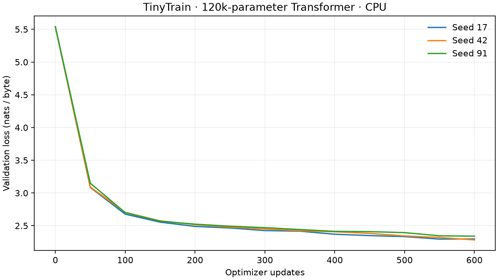

# TinyTrain

[](https://github.com/adi-x-ak/tinytrain/actions/workflows/check.yml)

A small Transformer training system with a concrete question: **does changing
batching, synchronization, or checkpoint recovery preserve the optimizer update?**

The attention, sampler, training loop, and gradient reducer are implemented here.
PyTorch supplies tensors, autograd, AdamW, and Gloo. Five core modules keep the
whole training path readable.

## Evidence

| Check | Measured result |
|---|---|
| Attention outputs and gradients | Match PyTorch SDPA within the asserted float64 tolerances |
| Future-token isolation | Earlier outputs remain exactly unchanged |
| Gradient accumulation | Matches full-batch parameters within `1e-10` |
| Two workers: manual all-reduce and DDP | Maximum parameter error `1.11e-16` after five updates |
| Two-worker AdamW state | Maximum tensor error `1.39e-17` |
| Checkpoint recovery | Six continuous vs. 3 + save/load + 3 updates: exact model and optimizer match |
| Shakespeare learning study | Final validation loss **2.307 nats/byte**, mean of three seeds |



Measured on an Apple M4 Pro, 24 GB RAM, CPU, one thread, Python 3.12.14, PyTorch
2.14.1. The 120,064-parameter model trained for 600 updates per seed. Final losses
ranged from 2.283 to 2.340. Recorded loop times were 4.49–4.57 seconds, including
periodic evaluation and checkpointing. These are local observations, not a
benchmark record or a cluster scaling result.

Raw evidence: [training observations](results/training.json),
[distributed comparison](results/verification.json), and [method](docs/design.md).

## Run

Python 3.11 or newer; CPU is sufficient. Run commands from this repository.

```bash
python -m venv .venv
source .venv/bin/activate
python -m pip install -e '.[dev]'
python scripts/fetch_data.py
tinytrain train --data data/shakespeare.txt --output runs/demo --steps 600
tinytrain sample runs/demo/checkpoint.pt --prompt 'ROMEO:' --tokens 120
```

The fetch script pins the source revision and checks the corpus hash. The model
learns local text patterns; the short training run does not produce a capable
conversational model.

Resume to a **total** update count with the same model and training settings:

```bash
tinytrain train --data data/shakespeare.txt --output runs/demo \
  --resume runs/demo/checkpoint.pt --steps 900
```

For two local CPU workers, keep `--batch` as the global batch size:

```bash
torchrun --master-addr=127.0.0.1 --master-port=29500 --nproc-per-node=2 \
  -m tinytrain.cli train --data data/shakespeare.txt --output runs/workers \
  --batch 16 --accumulate 2 --sync manual --steps 100
```

Use `--sync ddp` for the reference path. The global batch must divide evenly
across workers and microbatches. CPU-only, single-host runs are the supported scope.

## Read the code

| File | Responsibility |
|---|---|
| [model.py](src/tinytrain/model.py) | Causal attention and decoder blocks |
| [data.py](src/tinytrain/data.py) | Byte windows and independent sampler state |
| [train.py](src/tinytrain/train.py) | Accumulation, optimizer updates, evaluation, recovery |
| [distributed.py](src/tinytrain/distributed.py) | Process group and explicit gradient averaging |
| [cli.py](src/tinytrain/cli.py) | Train and sample commands |

## Reproduce the checks

```bash
ruff check .
ruff format --check .
pytest -q
python scripts/verify.py
python scripts/study.py  # fresh runs/study directory required
```

`verify.py` launches actual Gloo workers, tests both synchronization paths, and
writes their errors. `study.py` reproduces the three seeded training runs and
chart. [requirements-repro.txt](requirements-repro.txt) records the exact packages
used for the published macOS/Python 3.12 experiment; install it before the editable
package to reproduce that environment. Hardware and runtime changes can affect
rounding and timing.

MIT-licensed code. Dataset provenance and prior work are documented in
[design.md](docs/design.md).
